  

  

### About Me

I'm Dat Tran Gia, also known as Rango, a CCNA-certified network engineer in Ho Chi Minh City moving into **DevSecOps**. I started at the switch port with VLANs, STP, OSPF and access-layer security. Now I'm taking the same habits into cloud infrastructure and delivery pipelines: build it, break it on purpose, verify the fix and write it down.

- **[CCNA Labs](https://github.com/RangoGM/ccna-labs)**: 36 labs built in Cisco Packet Tracer and CML, each with a topology, configs, verification steps and a write-up.
- **RangoNetwork**: A CCNA learning platform I build and run end to end, on AWS and Kubernetes with Terraform, security checks in CI and Grafana monitoring.
- **Next Up**: AWS Solutions Architect Associate in November 2026, then Kubernetes, from CKA to CKS.

  

  

  

  

  

  

  

<!-- Counts profile views without showing a badge; the Live profile cards workflow reads the count for the stats badge above. -->

